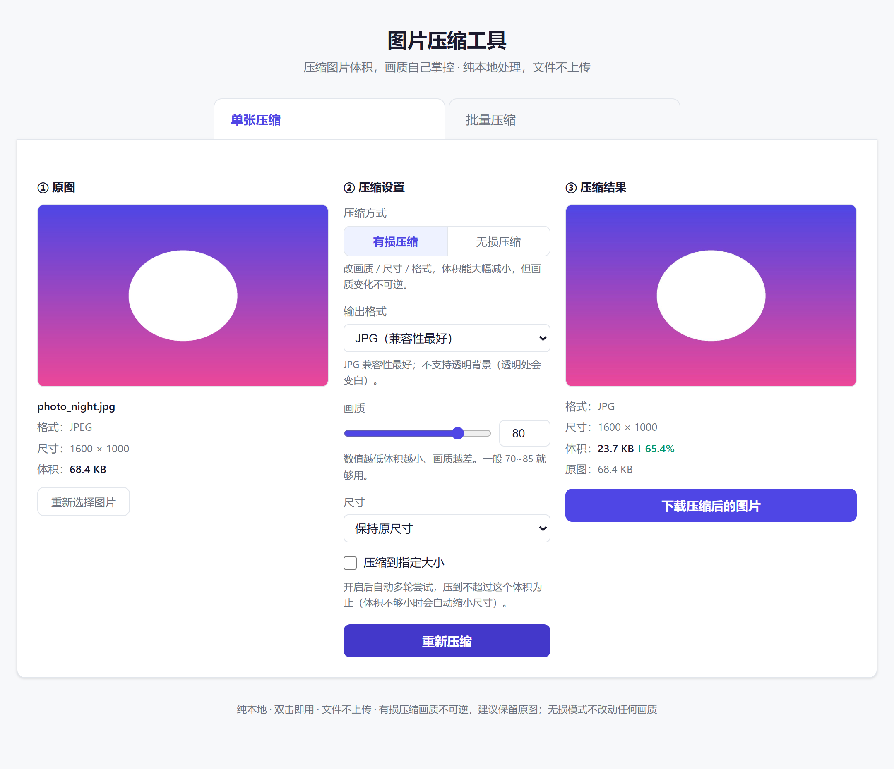
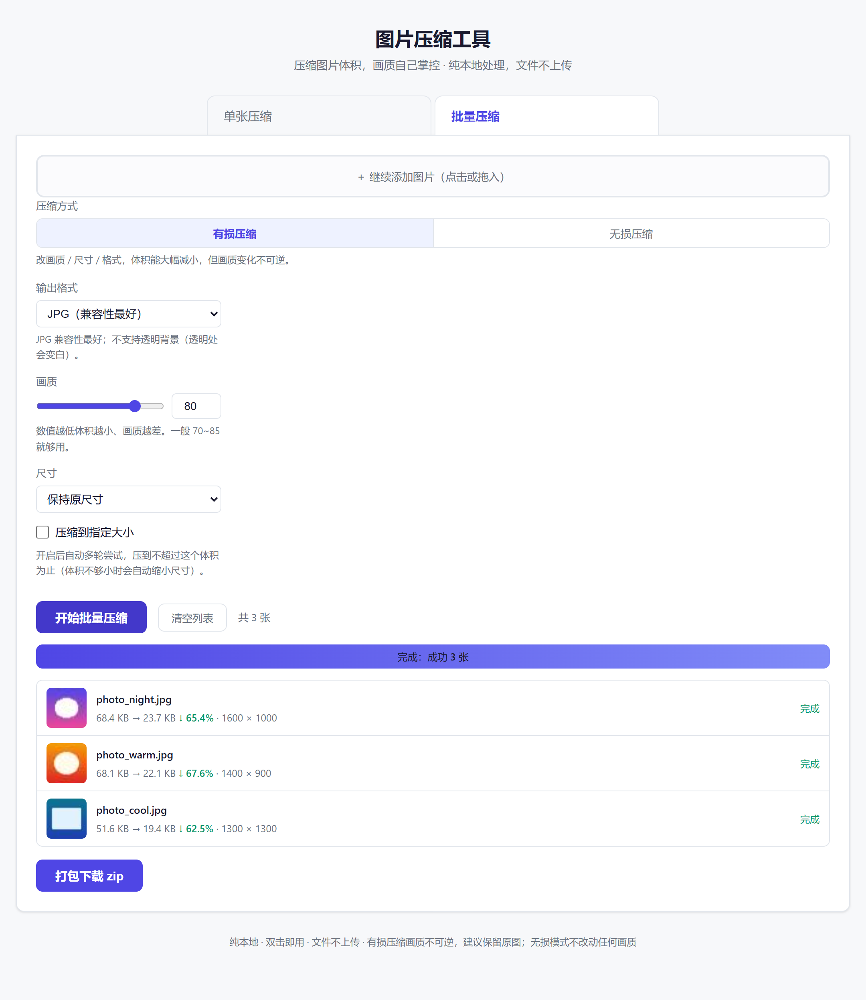

# 图片压缩工具

一个**纯前端、免安装、图片不上传**的在线图片压缩工具。所有处理都在你的浏览器本地完成，隐私安全。




## 功能
原版在这里：
https://github.com/huimengshiyezi
原版在线使用：https://huimengshiyezi.github.io/img-compress/
在此基础上修改了两个地方
1.去掉了图片设置里面的限制最长边的这个选项，增加了两个设置a.限制图片宽度，图片高度按照原图比例缩放。b.限制图片高度，图片宽度根据原图比例缩放
2.原来的压缩后的文件名会自动加上.compresed，这个在实际使用中不方便，予以去掉

### 单张压缩（左上传 / 中参数 / 右结果）

**有损模式参数**
- **输出格式**：JPG（兼容性最好）/ WebP（体积最小）/ PNG（无损）
- **画质**：1~100 滑块，数值越低体积越小
- **尺寸**：保持原尺寸 / 按百分比缩放 / 限制最长边
- **压缩到指定大小**：输入目标体积（KB 或 MB），自动多轮尝试压到不超过该体积（压不到位会自动缩小尺寸）

**无损模式**：无需参数，格式、尺寸、画质全部保持原样

结果区显示压缩后参数 + 压缩率 + 一键下载。

### 批量压缩

- 点击多选或把图片（整个文件夹）拖进来，一次可处理上百张
- 统一设置压缩方式与参数，一键全部处理
- 列表逐张显示：缩略图、原体积 → 处理后体积、压缩率、尺寸、状态
- 单张失败不影响其他张
- 全部完成后**打包成 zip 一次性下载**（文件名自动防重名）



## 两种压缩方式

顶部可切换，两种互相独立：

| | 有损压缩（默认） | 无损压缩 |
|---|---|---|
| 做什么 | 改画质 / 缩尺寸 / 换格式 | 只剥离元数据，PNG 额外做真正的无损重压 |
| 画质 | 会降（可控） | **一个像素都不改** |
| 尺寸 / 格式 | 可改 | 保持原样 |
| 体积降幅 | 大，可到 80%+ | PNG 常见 5%~25%；JPG/WebP 看元数据多少 |
| 适合 | 发公众号配图、网页用图 | 存档、想缩小体积又绝不能掉画质 |

## 使用方式

**方式一（推荐）**：下载 `index.html`，双击直接用。纯前端工具，不需要启动任何服务，断网也能用。

**方式二**：在线使用 —— https://wuhanpizi.github.io/img-compress/

## 隐私说明

- ✅ 所有处理在浏览器本地完成，图片**不会**上传到任何服务器
- ✅ 无后端、无数据库、无第三方统计、无网络请求
- ✅ 纯前端单文件，代码全部可审计
- ✅ 无损模式会剥离元数据（含 EXIF、AI 生成参数），顺带保护隐私

## 项目结构

```
img-compress/
├── index.html                 全部功能（零依赖单文件）
├── docs/
│   ├── screenshot.png         界面截图（单张）
│   └── screenshot-batch.png   界面截图（批量）
├── LICENSE
└── README.md
```

## 技术说明

### 有损压缩

- Canvas 重绘 + `toBlob(format, quality)` 重编码（浏览器原生编码器：libjpeg-turbo / libwebp）
- 目标大小：先用最低画质试压，能达标就二分质量逼近；最低画质仍超标则按面积比例缩小尺寸再试
- JPEG 不支持透明，透明处会填白底

### 无损压缩（纯 JS 实现，零依赖）

三种格式都走"字节级处理"，全程不解码重编码像素：

- **JPEG**：解析 marker 段，丢弃 EXIF / XMP / Photoshop / 注释等 APPn、COM 段，图像数据原样保留。**检测到 EXIF 旋转标记（Orientation ≠ 1）时自动保留 EXIF**，避免照片方向错乱
- **PNG**：丢弃 tEXt / zTXt / iTXt / tIME / eXIf 元数据块，再用浏览器原生 `DecompressionStream` / `CompressionStream` 解开 IDAT、按最小绝对差启发式重选每行滤波器、重新 deflate 压缩后重建 IDAT
- **WebP**：解析 RIFF 容器，丢弃 EXIF / XMP 块并修正 VP8X 标志位与 RIFF 长度
- **保险机制**：任何一步输出的体积 ≥ 原文件时，直接返回原文件（提示"已经是最优状态"）；不支持交错 PNG 的重新滤波（仅剥元数据）

### ZIP 打包

自实现 store 模式（CRC32 校验 + 本地文件头 + 中央目录），含中文文件名（UTF-8 标记），不引入任何第三方库。

## 注意事项

- **有损压缩画质变化不可逆**，重要图片建议先留原图（批量模式下载的是 zip，原图不动）
- **无损压缩可以放心用**：像素逐字节不变，已用 Pillow 逐图比对验证；元数据（含 AI 生成参数）会被剥掉，这是省体积也是保护隐私
- 无损模式不支持 GIF / BMP / AVIF 等其他格式，会明确提示切到有损模式
- 极小的 JPG 转 JPG 可能反而变大（有损模式会显示橙色警示），这时建议改用无损模式或保持原样
- WebP 体积通常最小，画质接近 JPG，现代浏览器都支持

## 浏览器要求

Chrome / Edge 90+、Firefox 113+、Safari 16.4+（无损模式依赖 `CompressionStream` API）。

## License

[MIT](LICENSE)
